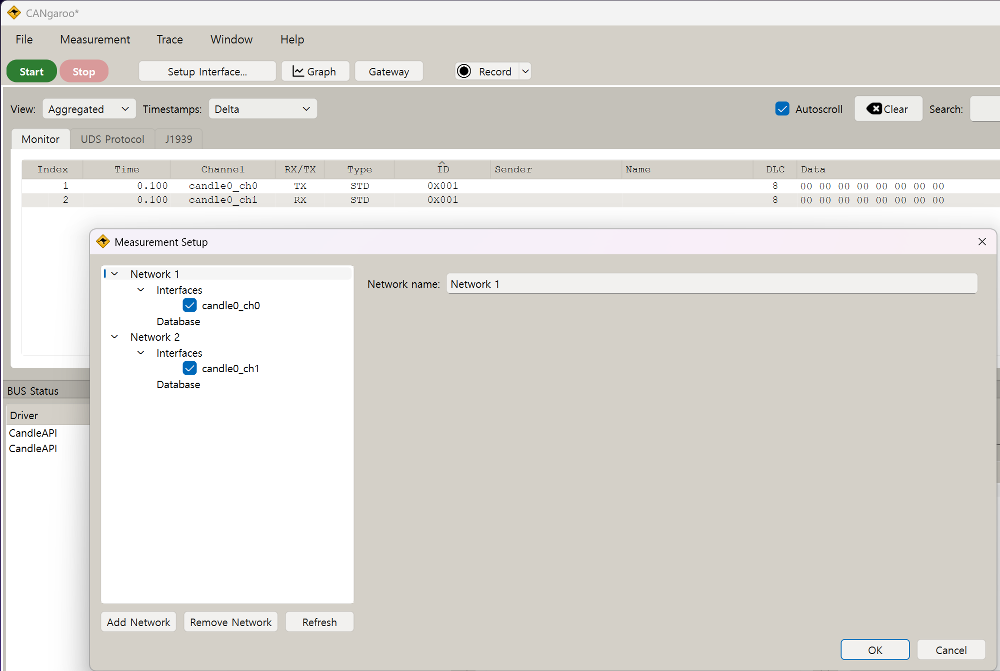

[한국어](README.md) | **English**

# ESP32-S31 CAN-FD 2-Port Test

A 2-port CAN-FD program for the ESP32-S31, built with ESP-IDF v6.1. One board plays three roles:

- **Console tester**: configure both ports from the UART0 console and test TX/RX and bus error handling.
- **USB-CAN adapter**: a Candlelight (gs_usb) device on the high-speed USB port. cangaroo sees two CAN channels.
- **OBD-II ECU simulator**: answers OBD requests on ports in mode 2, at the same time as the cangaroo monitor.

Design details are in [docs/LLM_WIKI.md](docs/LLM_WIKI.md) and the full console reference is in
[docs/CONSOLE_COMMANDS.md](docs/CONSOLE_COMMANDS.md) (both in Korean).

## Hardware

| Item | Details |
|---|---|
| Board | ESP32-S31-Function-CoreBoard-1 (ESP32-S31-WROOM-3, 16 MB flash) |
| PSRAM | 16 MB octal (AP Memory 128 Mbit), 200 MHz, added to the heap |
| CAN1 | TX GPIO35 (J2-25), RX GPIO36 (J2-24) |
| CAN2 | TX GPIO37 (J2-23), RX GPIO38 (J2-22) |
| Console | UART0 (TX GPIO59, RX GPIO58) through the on-board USB-UART bridge. Flashing uses the same port |
| USB-CAN | High-speed USB OTG port. VID 0x303A, PID 0x4C31 |

The board has no CAN transceivers. Connect a CAN-FD transceiver (TJA1051, TCAN1042, ...) to each port.

- Use 3.3 V logic levels. If the transceiver has a VIO pin, connect it to 3.3 V.
- Connect CANH to CANH and CANL to CANL between the two transceivers.
- Put a 120 Ω termination resistor at each end of the bus.
- Connect the transceiver GND to the board GND.

## Build and flash

The ESP32-S31 is a preview target in IDF v6.1, so `--preview` is needed.

```bash
idf.py --preview set-target esp32s31
idf.py build
idf.py -p COMx flash monitor
```

The sdkconfig in this folder is already set up for the esp32s31.
Run set-target again only after deleting the sdkconfig.

Pins, default bitrates, queue depths and the USB PID are set in menuconfig
under `CAN-FD 2-Port Test Configuration`.

## Using both CAN channels in cangaroo

Connected to a PC through its high-speed USB port, the board shows up as a Candlelight (gs_usb)
compatible USB-CAN adapter. The WinUSB driver is bound automatically, so nothing needs to be installed on Windows.

[cangaroo v0.7.0](https://github.com/Schildkroet/CANgaroo/releases/tag/V0.7.0) (upstream release)
works with both ports out of the box.



| cangaroo interface | Board port |
|---|---|
| `candle0_ch0` | CAN1 |
| `candle0_ch1` | CAN2 |

Steps:

1. In cangaroo, open **Measurement → Setup Interface...**.
2. Put `candle0_ch0` and `candle0_ch1` into separate networks and check both.
3. Select each interface and set the bitrate, plus the data bitrate for CAN FD.
4. Press **Start**.

The screenshot was taken with CAN1 and CAN2 on the same bus:
a frame sent on `candle0_ch0` (TX) is received on `candle0_ch1` (RX).

Notes:

- v0.7.0 has a timing table for an 80 MHz CAN clock: nominal 10 kbit/s to 1 Mbit/s and data 2/4/5/8 Mbit/s.
  The sample point is fixed by the table (mostly 87.5 %).
- v0.7.0 uses the legacy gs_usb protocol, where both channels share one USB interface.
  The measured receive throughput with the legacy protocol is about 5,600 frames/s.
- The firmware also supports the ElmueSoft (CANable 2.5) protocol. With the cangaroo fork that uses it
  ([firepooh/CANgaroo](https://github.com/firepooh/CANgaroo), branch `weact-local`):
  - each channel has its own USB interface, and about 16,600 frames/s were received without loss;
  - the sample point can be set freely.
- A channel can only be started when its port is in mode 1 or mode 2. The default is mode 1 (see below).
- When the firmware rejects a channel start (for example on a mode 0 port), cangaroo shows no error.

## Port modes and the OBD-II ECU

Each port has a mode stored in NVS. Change it with the console command `mode <port> <0|1|2>`.

| Mode | Behavior |
|---|---|
| 0 | Off. The port is not opened at boot, and cangaroo cannot start it |
| 1 | USB adapter only. cangaroo opens and closes the port (default) |
| 2 | USB adapter + OBD-II ECU simulator. The ECU always runs |

On a mode 2 port:

- Without cangaroo, the port runs at 500 kbit/s classic CAN and the ECU answers.
- When cangaroo starts the channel, the port is reopened with cangaroo's settings and the ECU keeps answering.
- cangaroo shows both the requests and the ECU responses.

The ECU answers 7DF and its physical request ID (default 7E0). The response ID is the request ID + 8.
Supported requests:

- Service 01: PIDs 05, 0C, 0D, 1F, 2F, A6 and the supported-PID ranges
- Service 09: VIN
- Services 03 and 04: read and clear DTCs

Values, enabled items, the VIN and the DTC list are set with the `obd` command and stored in NVS.
Usage and request/response examples are in [docs/CONSOLE_COMMANDS.md](docs/CONSOLE_COMMANDS.md).

## Console commands

Connect to UART0 (115200 8N1). The prompt is `canfd>`.
Only mode 2 ports are opened at boot; open the others with `can_init`.
The defaults are 500 kbit/s nominal and 2 Mbit/s data.

| Command | Function |
|---|---|
| `can_init [port] [-b bps] [-d bps] [-m mode] [-c] ...` | Open or reconfigure ports |
| `can_deinit [port]` | Close ports |
| `can_send <port> <id> [data] [-e] [-f] [-b] [-r] [-l n] [-n n] [-p ms]` | Send frames |
| `can_dump [port] [on\|off]` | Print received frames |
| `can_status [port] [-c]` | State, error counters and statistics |
| `can_recover [port]` | Recover from bus-off |
| `can_errlog [port] [on\|off]` | Bus error summary log on/off (default on) |
| `can_fault <port> <dominant\|recessive\|off>` | Inject or clear a fault on the TX pin |
| `can_test [-D dir] [-n n] [-l n] ...` | Transfer test between the two ports |
| `mode [port 0\|1\|2]` | Show or set the port mode |
| `obd [port ...]` | Show or change the OBD ECU settings |
| `usb` | USB connection, speed, protocol and channel state |
| `mem [-t KB] [-b KB] [-s]` | Internal RAM and PSRAM usage. `-t` test, `-b`/`-s` background load |
| `help [cmd]` | Command help |

Ports are given as `1`, `2` or `all` (`can1`, `can2` also work). IDs and data are hexadecimal.

### can_init options

- `-b`, `--bitrate`: nominal (arbitration) bitrate
- `-d`, `--dbitrate`: data-phase bitrate
- `-c`, `--classic`: classic CAN only
- `--sp`, `--dsp`: nominal / data sample point (‰). 0 uses the driver default.
- `--dssp`: data-phase secondary sample point (transmitter delay compensation, ‰)
- `-r`, `--retry`: retransmission limit -1..15, -1 = forever
- `-a`, `--autorecover`: start bus-off recovery after this time (ms). 0 = manual (`can_recover`)
- `-m`, `--mode`: `normal`, `listen`, `selftest`

### can_send options

- `-e`: 29-bit extended ID. IDs above 0x7FF are extended automatically.
- `-f`: CAN-FD frame (up to 64 bytes)
- `-b`: bit rate switch (BRS), implies `-f`
- `-r`: remote frame (classic only), `-l` is the requested DLC
- `-l`: payload length. Without data the payload is filled with 0, 1, 2, ...
- `-n`, `-p`: number of frames and interval (ms)

After sending, the command prints the number of queued, sent and failed frames and the current state.
In bus-off it also shows how to recover.

Valid FD lengths are 0-8, 12, 16, 20, 24, 32, 48 and 64.
Other lengths are padded with 0x00 up to the next valid length.

### can_test

The sending port sends frames back to back and the receiving port checks their order and payload.
The first 4 bytes hold a sequence number; the rest is a pattern derived from it.

| `-D` | Behavior |
|---|---|
| `both` (default) | CAN1→CAN2, then CAN2→CAN1 |
| `dual` | Both directions at the same time (arbitration test) |
| `12`, `21` | One direction only |
| `11`, `22` | Single-port loopback (needs selftest mode) |

Other options:

- `-n`: frames per direction (default 100)
- `-l`: payload length (default 64 for FD, 8 for classic)
- `-i`: CAN1→CAN2 ID (default 0x100); the reverse direction uses ID+1
- `-e`: extended ID, `-c`: classic frames, `--nobrs`: FD frames without BRS
- `-g`: interval between frames (ms), `-t`: receive timeout (ms)

The result shows sent, received, mismatched, lost and duplicated frames,
the elapsed time, the throughput and the bus error increments per port.
The test passes when all frames arrive in order with the right payload.

Running `can_init` on a mode 2 port, or using a mode 2 port as the receiver of `can_test`,
detaches the ECU. Attach it again with `mode <port> 2`.

### Examples

```text
canfd> can_status
canfd> can_test
canfd> can_test -D dual -n 1000
canfd> can_test -D 12 -c -l 8
canfd> can_init all -b 1000000 -d 5000000
canfd> can_send 1 123 11223344
canfd> can_send 2 1ABCDEF0 -b -l 64 -n 10 -p 100
canfd> can_dump 2
```

## Bus error handling

- **Error summary log:** while errors occur, each port prints one summary line every 500 ms
  with the increment per error type, the tx_fail increment, the state and TEC/REC. Turn it off with `can_errlog`.
  When cangaroo starts a channel, the log of that port is turned off and stays off even after the console
  reopens the port. Turn it back on with `can_errlog on`.
- **State change log:** changes to ERROR_WARNING, ERROR_PASSIVE and BUS_OFF are logged as warnings,
  the return to ERROR_ACTIVE as info.
- **Statistics:** `can_status` shows the err_passive, bus_off and recover counts and any injected fault.
- **Automatic recovery:** enable it with `can_init -a <ms>`. Recovery starts that long after bus-off.
  The default is `CANFD_DEFAULT_AUTO_RECOVER_MS` in menuconfig (0 = manual).
- **TX slot reclaim:** at bus-off the frames in the hardware buffer are reported as failed and their TX slots are returned.

### Fault injection (`can_fault`)

The TX pin is taken away from the controller and held as a GPIO. It also works on a closed port.

| Value | Pin | Simulated fault |
|---|---|---|
| `dominant` | TX held low | A node holding the bus dominant |
| `recessive` | TX held high | Broken TX line, the node cannot drive the bus |
| `off` | Returned to the controller | Normal |

Reopening the port with `can_init` clears the fault.

### Tested scenarios

Results on a bus with two transceivers, 500 kbit/s nominal and 2 Mbit/s data.
The tests were run again on 2026-11-12 to confirm the results.

| Scenario | How | Result |
|---|---|---|
| No other node (ACK error) | `can_deinit 2`, then send on CAN1 | WARNING at TEC 96, PASSIVE at 128. TEC stops rising and the frame is retried |
| Other node back | `can_init 2` in the state above | Pending frame delivered, WARNING at TEC 127, ACTIVE after 40 good frames |
| Retry limit | `can_init 1 -r 3` | Each frame is tried 4 times, then dropped and counted as tx_fail |
| Single shot | `can_init 1 -r 0` | Dropped after one ACK error, TEC +8 |
| Other node listen-only | `can_init 2 -m listen` | ACK errors on CAN1, which goes PASSIVE. CAN2 first sees form errors; once CAN1 is PASSIVE, CAN2 receives every retransmission |
| Nominal bitrate mismatch | CAN2 `-b 250000` | Both nodes go PASSIVE with stuff/form errors, no bus-off |
| Mismatch fixed | `can_init 2` | Frames delivered. CAN1 stays PASSIVE at REC 511, goes WARNING after the first received frame and ACTIVE after about 40 |
| Data bitrate mismatch | CAN2 `-d 1000000` | All BRS frames fail (bit errors on TX, stuff errors on RX). 200 FD frames without BRS pass |
| No TDC setting | no `--dssp`, data 5/8 Mbit/s | PASS. The reset default "measured delay + 10 clocks" already enables TDC |
| Bus stuck dominant (idle) | `can_fault 2 dominant` | REC rises on both nodes for a few ms, then the transceiver dominant timeout releases the bus |
| Bus dominant (while sending) | `can_fault 2 dominant` while CAN1 retries | CAN1 bit errors, TEC 256, BUS_OFF. The pending frame is counted as tx_fail |
| Manual bus-off recovery | `can_recover 1` | ACTIVE after about 26 ms, TEC/REC 0. Both directions pass afterwards |
| Broken TX line | `can_fault 1 recessive`, then send | BUS_OFF within about 2 ms per frame |
| Automatic recovery | `can_init 1 -a 200` + broken TX line | Recovery every 200 ms, repeated bus-off. Normal after the fault is cleared |
| `can_test` during a fault | broken TX line | FAIL, reporting the bus-off, recovery and tx_fail counts (e.g. 5, 4 and 17; they vary between runs) |
| After clearing the fault | `can_fault 1 off` | 500 frames per direction pass, no TX slot leak |

Notes:

- Transceivers have a TXD dominant timeout, so `can_fault dominant` cannot hold the bus dominant for long.
  Real bus shorts (CANH-CANL, CANH-GND) have to be wired.
- REC only decreases on successful reception, so a node that only transmits can stay PASSIVE for a long time.
- A PASSIVE transmitter sends recessive error flags that other nodes do not see,
  so a listen-only node accepts the unacknowledged retransmissions as valid frames.
- Closing or reopening a port in bus-off makes IDF log `node already disabled` / `node is bus off` errors. They are harmless.

## PSRAM

`CONFIG_SPIRAM` adds the 16 MB PSRAM to the heap. The settings are in `sdkconfig.defaults`.

- Octal mode at 200 MHz. Timing tuning and a memory test run at boot.
- `malloc()` puts blocks up to 16 KB in internal RAM and larger blocks in PSRAM.
- The boot memory test adds about 0.36 s. Turn off `CONFIG_SPIRAM_MEMTEST` if not needed.

### CAN queues in PSRAM

With `CONFIG_CANFD_QUEUE_IN_PSRAM` (default on), the CAN buffers used by the ISR are placed in PSRAM.

| Buffer | Size (per port) | Location |
|---|---|---|
| RX event queue storage | 1024 x 104 B (about 104 KB) | PSRAM |
| TX free-slot queue storage | 68 x 2 B | PSRAM |
| TX frame pool | 68 x 112 B | PSRAM |
| Queue control blocks (StaticQueue_t) | tens of bytes | Internal RAM |
| Driver TX queue (64 entries) | allocated by the driver | Internal RAM |

- The queue control blocks contain spinlocks. Atomic instructions on PSRAM are not documented for the S31,
  so they stay in internal RAM.
- Queue depths are `CANFD_RX_QUEUE_DEPTH` (default 1024) and `CANFD_TX_QUEUE_DEPTH` (default 64) in menuconfig.
- `can_status` shows the buffer addresses, their location (PSRAM/internal) and the peak usage.
- `can_test -w <us>` slows down the receiver on purpose to fill the RX queue.
- `mem -b <KB>` starts a background PSRAM load; `mem -s` stops it and prints the result.

High-load results (bus_err and payload mismatches were 0 in every test):

| Test | Conditions | Result |
|---|---|---|
| `can_test -D dual -n 20000` | 500k/2M, 64 B, both directions | 40,000 frames PASS, all 68 TX pool slots used |
| `can_test -D dual -n 20000 -l 8` | 1M/8M, 8 B (bus about 21,500 frames/s) | 40,000 frames PASS |
| `can_test -D dual -n 20000` | 1M/8M, 64 B | 40,000 frames PASS, about 6.4 Mbit/s in total |
| `can_test -D 12 -n 1300 -l 8 -w 200` | Fill the RX queue | PASS, rxq_peak 990/1024, rx_drop 0 |
| `can_test -D 12 -n 3000 -l 8 -w 200` | Overflow the RX queue | FAIL (intended), rxq_peak 1024, rx_drop 1265 = RX lost 1265, all 1735 received frames correct |
| `mem -b 4096` + `can_test -D dual -n 20000 -l 8` | 1M/8M under PSRAM load | 40,000 frames PASS. The PSRAM load wrote/verified about 1.8 GB without errors |

Moving the queues to PSRAM freed about 30 KB of internal RAM (406 KB to 436 KB).
With the USB adapter and the OBD ECU added since then, about 389 KB of internal RAM is free with both ports open.

Board output:

```text
I esp_psram: Found 16MB PSRAM device
I esp_psram: Speed: 200MHz
I esp_psram: SPI SRAM memory test OK
I esp_psram: Adding pool of 16384K of PSRAM memory to heap allocator
canfd> mem -t 12288
PSRAM test: 12288 KB  write 66278 KB/s  read 75238 KB/s  errors 0  PASS
```

## Notes

- The default retry limit is unlimited (-1). Without an ACK from another node the same frame is retried forever.
  Check TEC and ack errors with `can_status`, fix the wiring and reopen the port with `can_init`.
- TDC is on by default (measured transmitter delay + 10 clocks) and passed up to 8 Mbit/s without `--dssp`.
  Use `--dssp` only to set the secondary sample point explicitly.
- To test a single port, run `can_init 1 -m selftest` and then `can_test -D 11`.
  Without a transceiver, connect the port's TX and RX pins with a jumper.

## Source layout

| File | Role |
|---|---|
| `main/app_main.c` | Starts the console REPL, registers commands, applies port modes, starts USB |
| `main/canfd_port.c` | TWAI driver wrapper: TX frame pool, RX queue, per-port RX task |
| `main/cmd_canfd.c` | `can_*` console commands and `can_test` |
| `main/cmd_system.c` | `mem` command |
| `main/ch_mode.c` | Stores and applies port modes; splits mode 2 traffic between USB and the ECU |
| `main/obd_ecu.c` | OBD-II ECU simulator |
| `main/cmd_mode.c` | `mode` and `obd` commands |
| `main/candle.c` | Candlelight / ElmueSoft protocol handling |
| `main/candle_usb.c` | USB descriptors, WinUSB (MS OS 2.0), `usb` command |
