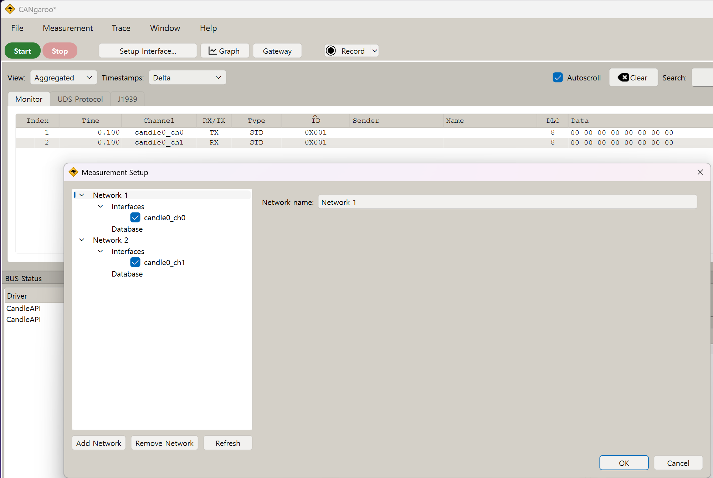

**한국어** | [English](README.en.md)

# ESP32-S31 CAN-FD 2포트 테스트

ESP-IDF v6.1 기반 ESP32-S31 CAN-FD 2포트 프로그램이다. 보드 하나가 세 가지 역할을 한다.

- **콘솔 시험기**: UART0 콘솔 명령으로 두 포트를 설정하고 송수신과 버스 에러 처리를 시험한다.
- **USB-CAN 어댑터**: HS USB 포트에서 Candlelight(gs_usb) 장치로 동작한다. cangaroo에서 CAN 2채널로 쓴다.
- **OBD-II ECU 시뮬레이터**: 포트별 MODE2에서 OBD 요청에 응답한다. cangaroo 모니터와 동시에 동작한다.

자세한 구조는 [docs/LLM_WIKI.md](docs/LLM_WIKI.md)에, 콘솔 명령 전체는 [docs/CONSOLE_COMMANDS.md](docs/CONSOLE_COMMANDS.md)에 있다.

## 웹 플래셔

**<https://firepooh.github.io/ESP32S31-CANFD/>**

1. 데스크톱 Chrome이나 Edge로 연다.
2. 보드의 USB-UART(CP210x) 포트를 PC에 연결한다.
3. 버전을 고르고 **연결** → **플래시**를 누른다.

바이너리와 esptool 명령은 [Releases](https://github.com/firepooh/ESP32S31-CANFD/releases)에 있다.

## 하드웨어

| 항목 | 내용 |
|---|---|
| 보드 | ESP32-S31-Function-CoreBoard-1 (ESP32-S31-WROOM-3, 플래시 16 MB) |
| PSRAM | 16 MB Octal (AP Memory 128 Mbit), 200 MHz, 힙에 추가 |
| CAN1 | TX GPIO35 (J2-25), RX GPIO36 (J2-24) |
| CAN2 | TX GPIO37 (J2-23), RX GPIO38 (J2-22) |
| 콘솔 | UART0 (TX GPIO59, RX GPIO58), 보드의 USB-UART 브리지. 플래시와 콘솔을 같은 포트로 사용 |
| USB-CAN | HS USB OTG 포트. VID 0x303A, PID 0x4C31 |

보드에는 CAN 트랜시버가 없다.
포트마다 CAN-FD 트랜시버(TJA1051, TCAN1042 등)를 따로 연결한다.

- 트랜시버의 로직 전압은 3.3 V에 맞춘다. VIO 핀이 있으면 3.3 V에 연결한다.
- 두 트랜시버의 CANH끼리, CANL끼리 연결한다.
- 버스 양 끝에 120 Ω 종단 저항을 단다.
- 트랜시버 GND와 보드 GND를 연결한다.

## 빌드와 플래시

ESP32-S31은 IDF v6.1에서 프리뷰 타깃이므로 `--preview`를 붙인다.

```bash
idf.py --preview set-target esp32s31
idf.py build
idf.py -p COMx flash monitor
```

이 폴더의 sdkconfig는 이미 esp32s31로 설정되어 있다.
sdkconfig를 지웠을 때만 set-target을 다시 실행한다.

`v*` 태그를 푸시하면 GitHub Actions가 빌드해 릴리즈와 웹 플래셔를 갱신한다.
- `-`가 들어간 태그(`v1.1.0-rc1`)는 프리릴리즈가 된다.
- `dependencies.lock`으로 컴포넌트 버전을 고정한다.

핀 번호, 기본 비트레이트, 큐 깊이, USB PID는 menuconfig에서 바꾼다.
메뉴 이름은 `CAN-FD 2-Port Test Configuration`이다.

## cangaroo로 CAN 2채널 쓰기

보드의 HS USB 포트를 PC에 연결하면 Candlelight(gs_usb) 호환 USB-CAN 어댑터로 인식된다.
WinUSB 드라이버가 자동으로 붙으므로 Windows에서 따로 설치할 것이 없다.

[cangaroo v0.7.0](https://github.com/Schildkroet/CANgaroo/releases/tag/V0.7.0)(원본 릴리즈)에서 바로 두 포트를 쓸 수 있다.



| cangaroo 인터페이스 | 보드 포트 |
|---|---|
| `candle0_ch0` | CAN1 |
| `candle0_ch1` | CAN2 |

사용 순서는 다음과 같다.

1. cangaroo에서 **Measurement → Setup Interface...**를 연다.
2. `candle0_ch0`과 `candle0_ch1`을 각각 다른 Network에 넣고 체크한다.
3. 인터페이스를 골라 비트레이트를 정한다. FD를 쓰려면 데이터 비트레이트도 정한다.
4. **Start**로 측정을 시작한다.

위 화면은 CAN1과 CAN2를 같은 버스에 묶은 상태에서 찍었다.
`candle0_ch0`으로 보낸 프레임(TX)을 `candle0_ch1`이 받은(RX) 결과다.

참고 사항은 다음과 같다.

- v0.7.0에는 80 MHz 클럭용 타이밍 표가 들어 있다.
  공칭 10 kbit/s~1 Mbit/s, 데이터 2/4/5/8 Mbit/s를 고를 수 있다. 샘플 포인트는 표에 정해진 값(대부분 87.5 %)이다.
- v0.7.0은 legacy gs_usb 프로토콜로 붙는다. 두 채널이 USB 인터페이스 하나를 같이 쓴다.
  legacy 프로토콜에서 시험한 수신 처리량은 약 5,600 frames/s다.
- 펌웨어는 ElmueSoft(CANable 2.5) 프로토콜도 지원한다. 이 프로토콜을 쓰는 cangaroo 포크
  ([firepooh/CANgaroo](https://github.com/firepooh/CANgaroo) `weact-local`)에서는 다음이 가능하다.
  - 채널마다 USB 인터페이스를 따로 쓴다. 손실 없이 약 16,600 frames/s를 받았다.
  - 샘플 포인트를 자유롭게 정한다.
- 채널은 포트 모드가 MODE1 또는 MODE2일 때만 열린다. 기본값은 MODE1이다. 아래 포트 모드를 본다.
- 펌웨어가 채널 열기를 거부해도 cangaroo에는 오류가 표시되지 않는다(예: MODE0 포트).

## 포트 모드와 OBD-II ECU

포트마다 모드를 정하고 NVS에 저장한다. 콘솔 명령 `mode <port> <0|1|2>`로 바꾼다.

| 모드 | 동작 |
|---|---|
| 0 | off. 부팅 때 열지 않고, cangaroo의 열기 요청도 거부한다 |
| 1 | USB 어댑터 전용. cangaroo가 열고 닫는다 (기본값) |
| 2 | USB 어댑터 + OBD-II ECU 시뮬레이터. ECU가 항상 동작한다 |

MODE2 포트의 동작은 다음과 같다.

- cangaroo가 없을 때는 500 kbit/s 클래식으로 열려 ECU가 응답한다.
- cangaroo가 채널을 열면 cangaroo 설정으로 다시 열리고, ECU는 계속 응답한다.
- cangaroo 화면에는 요청과 ECU 응답이 모두 보인다.

ECU는 7DF와 설정한 물리 주소(기본 7E0)에 응답하고, 응답 ID는 요청 주소 + 8이다. 지원 항목은 다음과 같다.

- 서비스 01: PID 05, 0C, 0D, 1F, 2F, A6, Supported PID
- 서비스 09: VIN
- 서비스 03, 04: DTC 읽기, 지우기

값, 항목 켜기·끄기, VIN, DTC는 `obd` 명령으로 정하고 NVS에 저장한다.
자세한 사용법과 요청·응답 예는 [docs/CONSOLE_COMMANDS.md](docs/CONSOLE_COMMANDS.md)에 있다.

## 콘솔 명령

UART0(115200 8N1)에 연결한다. 프롬프트는 `canfd>`이다.
부팅할 때는 MODE2 포트만 연다. 나머지 포트는 `can_init`으로 연다.
기본 설정은 공칭 500 kbps, 데이터 2 Mbps다.

| 명령 | 기능 |
|---|---|
| `can_init [port] [-b bps] [-d bps] [-m mode] [-c] ...` | 포트를 다시 설정한다 |
| `can_deinit [port]` | 포트를 닫는다 |
| `can_send <port> <id> [data] [-e] [-f] [-b] [-r] [-l n] [-n n] [-p ms]` | 프레임을 보낸다 |
| `can_dump [port] [on\|off]` | 수신 프레임을 출력한다 |
| `can_status [port] [-c]` | 상태, 에러 카운터, 통계를 보여 준다 |
| `can_recover [port]` | 버스 오프 상태에서 복구한다 |
| `can_errlog [port] [on\|off]` | 버스 에러 요약 로그를 켜거나 끈다 (기본 on) |
| `can_fault <port> <dominant\|recessive\|off>` | TX 핀에 고장을 주입하거나 해제한다 |
| `can_test [-D dir] [-n n] [-l n] ...` | 두 포트 사이 전송을 시험한다 |
| `mode [port 0\|1\|2]` | 포트 모드를 보거나 바꾼다 |
| `obd [port ...]` | OBD ECU 설정을 보거나 바꾼다 |
| `usb` | USB 연결 상태, 속도, 프로토콜, 채널 상태를 보여 준다 |
| `mem [-t KB] [-b KB] [-s]` | 내부 RAM과 PSRAM 사용량을 보여 준다. `-t` 시험, `-b`/`-s` 백그라운드 부하 |
| `help [cmd]` | 명령 도움말을 보여 준다 |

port는 `1`, `2`, `all`로 지정한다. `can1`, `can2`도 쓸 수 있다.
ID와 데이터는 16진수로 쓴다.

### can_init 옵션

- `-b`, `--bitrate`: 공칭(중재) 비트레이트
- `-d`, `--dbitrate`: 데이터 구간 비트레이트
- `-c`, `--classic`: 클래식 CAN만 사용
- `--sp`, `--dsp`: 공칭/데이터 샘플 포인트(‰). 0이면 드라이버 기본값을 쓴다.
- `--dssp`: 데이터 구간 보조 샘플 포인트(송신 지연 보상, ‰)
- `-r`, `--retry`: 재전송 한도 -1~15. -1은 무제한이다.
- `-a`, `--autorecover`: 버스 오프 뒤 이 시간(ms)이 지나면 복구를 시작한다. 0이면 수동(`can_recover`)이다.
- `-m`, `--mode`: `normal`, `listen`, `selftest`

### can_send 옵션

- `-e`: 29비트 확장 ID. ID가 0x7FF보다 크면 자동으로 확장 ID가 된다.
- `-f`: CAN-FD 프레임(최대 64바이트)
- `-b`: 비트레이트 전환(BRS). `-f`가 자동으로 켜진다.
- `-r`: 리모트 프레임(클래식 전용). `-l`이 요청 DLC가 된다.
- `-l`: 데이터 길이. 데이터를 생략하면 0, 1, 2, ... 패턴으로 채운다.
- `-n`, `-p`: 보낼 개수와 프레임 간격(ms)

송신이 끝나면 큐에 넣은 수, 실제로 보낸 수, 실패한 수와 현재 상태를 출력한다.
버스 오프 상태이면 복구 방법을 함께 안내한다.

FD 길이는 0~8, 12, 16, 20, 24, 32, 48, 64 중 하나다.
다른 길이를 주면 다음 규격 길이까지 0x00으로 채운다.

### can_test

송신 포트가 프레임을 연속으로 보내고, 수신 포트가 순서와 데이터를 검사한다.
데이터 앞 4바이트에는 일련번호를 넣고, 나머지는 일련번호로 만든 패턴을 넣는다.

| `-D` 값 | 동작 |
|---|---|
| `both` (기본) | CAN1→CAN2를 시험한 뒤 CAN2→CAN1을 시험한다 |
| `dual` | 두 방향을 동시에 보낸다 (중재 시험) |
| `12`, `21` | 한 방향만 시험한다 |
| `11`, `22` | 한 포트 자체 루프백을 시험한다 (selftest 모드 필요) |

그 밖의 옵션은 다음과 같다.

- `-n`: 방향당 프레임 수 (기본 100)
- `-l`: 데이터 길이 (기본 FD 64, 클래식 8)
- `-i`: CAN1→CAN2 ID (기본 0x100). 반대 방향은 ID+1을 쓴다.
- `-e`: 확장 ID, `-c`: 클래식 프레임, `--nobrs`: BRS 없는 FD 프레임
- `-g`: 프레임 간격(ms), `-t`: 수신 대기 시간(ms)

결과로 송신 수, 정상 수신 수, 데이터 불일치, 손실, 중복을 출력한다.
걸린 시간, 처리량, 포트별 버스 에러 증가분도 함께 출력한다.
모든 프레임이 순서대로 일치하면 PASS이다.

MODE2 포트에 `can_init`을 쓰거나 MODE2 포트를 `can_test`의 수신 쪽으로 쓰면 ECU가 빠진다.
이때는 `mode <port> 2`로 다시 붙인다.

### 사용 예

```text
canfd> can_status
canfd> can_test
canfd> can_test -D dual -n 1000
canfd> can_test -D 12 -c -l 8
canfd> can_init all -b 1000000 -d 5000000
canfd> can_send 1 123 11223344
canfd> can_send 2 1ABCDEF0 -b -l 64 -n 10 -p 100
canfd> can_dump 2
```

## 버스 에러 처리

펌웨어는 버스 에러를 다음과 같이 처리한다.

- **에러 요약 로그:** 에러가 나는 동안 포트마다 500 ms에 한 줄씩 요약을 출력한다.
  요약에는 에러 종류별 증가분, tx_fail 증가분, 상태, TEC/REC가 들어간다. `can_errlog`로 끈다.
  cangaroo가 채널을 열면 그 포트의 로그를 끄고, 콘솔에서 다시 열어도 꺼진 채로 남는다. 이때는 `can_errlog on`으로 켠다.
- **상태 변화 로그:** ERROR_WARNING, ERROR_PASSIVE, BUS_OFF로 바뀌면 경고로 출력한다.
  ERROR_ACTIVE로 돌아오면 정보 로그로 출력한다.
- **통계:** `can_status`에 err_passive, bus_off, recover 횟수와 주입한 고장을 표시한다.
- **자동 복구:** `can_init -a <ms>`로 켠다. 버스 오프 뒤 지정 시간이 지나면 복구를 시작한다.
  기본값은 menuconfig의 `CANFD_DEFAULT_AUTO_RECOVER_MS`(0 = 수동)이다.
- **TX 슬롯 회수:** 버스 오프 때 하드웨어 버퍼의 프레임은 실패로 돌아오고 TX 슬롯도 반환된다.

### 고장 주입 (`can_fault`)

TX 핀을 컨트롤러에서 떼어 GPIO로 고정한다. 닫힌 포트에도 걸 수 있다.

| 값 | 핀 상태 | 흉내 내는 고장 |
|---|---|---|
| `dominant` | TX Low 고정 | 노드가 버스를 우성으로 붙잡음 |
| `recessive` | TX High 고정 | TX 선 단선, 노드가 버스를 구동하지 못함 |
| `off` | 컨트롤러에 반환 | 정상 |

`can_init`으로 포트를 다시 열면 주입한 고장은 자동으로 풀린다.

### 시험한 시나리오와 결과

공칭 500 kbps, 데이터 2 Mbps, 트랜시버 2개를 묶은 버스에서 시험한 결과다.
2026-11-12에 같은 시험을 다시 돌려 결과를 확인했다.

| 시나리오 | 만드는 방법 | 결과 |
|---|---|---|
| 상대 노드 없음 (ACK 에러) | `can_deinit 2` 후 CAN1 송신 | TEC 96에서 WARNING, 128에서 PASSIVE. 그 뒤 TEC가 더 오르지 않고 재전송을 계속함 |
| 상대 노드 복귀 | 위 상태에서 `can_init 2` | 대기 프레임 전달, TEC 127로 WARNING. 정상 프레임 40개 뒤 ACTIVE |
| 재전송 한도 | `can_init 1 -r 3` | 프레임마다 4번 시도 뒤 버림. tx_fail로 집계 |
| 단발 송신 | `can_init 1 -r 0` | ACK 에러 1번 뒤 버림. TEC +8 |
| 상대가 listen-only | `can_init 2 -m listen` | CAN1은 ACK 에러로 PASSIVE. CAN2는 처음에 form 에러를 감지하고, CAN1이 PASSIVE가 된 뒤에는 재전송 프레임을 모두 받음 |
| 공칭 속도 불일치 | CAN2 `-b 250000` | 두 노드 모두 stuff/form 에러로 PASSIVE. 버스 오프는 나지 않음 |
| 속도 불일치 해소 | `can_init 2` | 프레임 전달. CAN1은 REC 511로 PASSIVE에 머물다가 첫 수신 뒤 WARNING, 수신 40개쯤 뒤 ACTIVE |
| 데이터 속도 불일치 | CAN2 `-d 1000000` | BRS 프레임 전부 실패(송신 bit 에러, 수신 stuff 에러). BRS 없는 FD 프레임 200개는 PASS |
| TDC 설정 없음 | `--dssp` 생략, 데이터 5/8 Mbps | PASS. 리셋 기본값이 "측정 지연 + 10클럭"이라 TDC가 이미 켜져 있음 |
| 버스 우성 고착 (유휴 중) | `can_fault 2 dominant` | 처음 수 ms 동안 두 노드 REC 상승. 그 뒤 트랜시버 우성 타임아웃으로 버스가 풀림 |
| 버스 우성 (송신 중) | CAN1 재전송 중 `can_fault 2 dominant` | CAN1 bit 에러 뒤 TEC 256, BUS_OFF. 송신 중 프레임은 tx_fail |
| 버스 오프 수동 복구 | `can_recover 1` | 약 26 ms 뒤 ACTIVE, TEC/REC 0. 이후 양방향 시험 PASS |
| TX 선 단선 | `can_fault 1 recessive` 후 송신 | 프레임마다 약 2 ms 안에 BUS_OFF |
| 자동 복구 | `can_init 1 -a 200` + TX 단선 | 200 ms마다 복구, 버스 오프 반복. 고장 해제 뒤 정상 |
| 고장 중 `can_test` | TX 단선 상태 | FAIL로 끝남. 버스 오프, 복구, tx_fail 횟수를 보고 (예: 5번, 4번, 17개. 시험마다 조금 다름) |
| 고장 해제 뒤 | `can_fault 1 off` | 양방향 500개 PASS, TX 슬롯 누수 없음 |

참고 사항은 다음과 같다.

- 트랜시버에는 TXD 우성 타임아웃이 있다. 그래서 `can_fault dominant`로는 버스를 계속 우성으로 묶을 수 없다.
  버스 자체의 단락(CANH-CANL, CANH-GND)은 배선으로 만들어야 한다.
- REC는 수신에 성공해야만 내려간다. 송신만 하는 노드는 REC 때문에 PASSIVE에 오래 머물 수 있다.
- 송신 노드가 PASSIVE이면 에러 플래그가 열성이라 다른 노드에 보이지 않는다.
  그래서 listen-only 노드는 ACK가 없는 재전송 프레임도 정상 프레임으로 받는다.
- 버스 오프 상태에서 포트를 닫거나 다시 열면 IDF가 `node already disabled`, `node is bus off` 에러 로그를 찍는다. 동작에는 문제가 없다.

## PSRAM

`CONFIG_SPIRAM`을 켜서 16 MB PSRAM을 힙에 추가했다. 설정은 `sdkconfig.defaults`에 있다.

- 모드는 8선(Octal), 클럭은 200 MHz다. 부팅할 때 타이밍 튜닝과 메모리 시험을 한다.
- `malloc()`은 16 KB 이하를 내부 RAM에, 그보다 큰 블록을 PSRAM에 할당한다.
- 부팅 시 메모리 시험 때문에 부팅이 약 0.36초 늘어난다. 필요 없으면 `CONFIG_SPIRAM_MEMTEST`를 끈다.

### CAN 큐를 PSRAM에 배치

`CONFIG_CANFD_QUEUE_IN_PSRAM`(기본 on)을 켜면 ISR이 쓰는 CAN 버퍼를 PSRAM에 둔다.

| 버퍼 | 크기 (포트당) | 위치 |
|---|---|---|
| RX 이벤트 큐 저장 공간 | 1024 x 104 B (약 104 KB) | PSRAM |
| TX 빈 슬롯 큐 저장 공간 | 68 x 2 B | PSRAM |
| TX 프레임 풀 | 68 x 112 B | PSRAM |
| 큐 제어 블록 (StaticQueue_t) | 수십 B | 내부 RAM |
| 드라이버 TX 큐 (64칸) | 드라이버 할당 | 내부 RAM |

- 큐 제어 블록에는 스핀락이 들어 있다. S31에서 PSRAM의 원자 명령 지원이 문서로 확인되지 않아 내부 RAM에 남겼다.
- 큐 깊이는 menuconfig의 `CANFD_RX_QUEUE_DEPTH`(기본 1024)와 `CANFD_TX_QUEUE_DEPTH`(기본 64)로 바꾼다.
- `can_status`는 버퍼 주소와 위치(PSRAM/internal), 최고 사용량(peak)을 보여 준다.
- `can_test -w <us>`는 수신 쪽 처리를 일부러 늦춰 RX 큐를 채운다.
- `mem -b <KB>`로 PSRAM 백그라운드 부하를 걸고, `mem -s`로 멈춘 뒤 결과를 본다.

고부하 시험 결과는 다음과 같다. 모든 시험에서 bus_err와 데이터 불일치는 0이었다.

| 시험 | 조건 | 결과 |
|---|---|---|
| `can_test -D dual -n 20000` | 500k/2M, 64 B, 양방향 동시 | 4만 개 PASS, TX 풀 68칸 모두 사용 |
| `can_test -D dual -n 20000 -l 8` | 1M/8M, 8 B (버스 약 21,500 frames/s) | 4만 개 PASS |
| `can_test -D dual -n 20000` | 1M/8M, 64 B | 4만 개 PASS, 합계 약 6.4 Mbit/s |
| `can_test -D 12 -n 1300 -l 8 -w 200` | RX 큐 채우기 | PASS, rxq_peak 990/1024, rx_drop 0 |
| `can_test -D 12 -n 3000 -l 8 -w 200` | RX 큐 넘치기 | FAIL(의도), rxq_peak 1024, rx_drop 1265 = RX lost 1265, 받은 1735개 데이터 모두 일치 |
| `mem -b 4096` + `can_test -D dual -n 20000 -l 8` | PSRAM 부하 중 1M/8M | 4만 개 PASS. PSRAM 부하 쪽도 약 1.8 GB 쓰기/검증 에러 0 |

큐를 PSRAM으로 옮긴 뒤 내부 RAM 여유는 약 30 KB 늘었다(406 KB에서 436 KB).
그 뒤 USB 어댑터와 OBD ECU를 넣어, 지금은 두 포트를 연 상태에서 내부 RAM 여유가 약 389 KB다.

보드에서 확인한 결과는 다음과 같다.

```text
I esp_psram: Found 16MB PSRAM device
I esp_psram: Speed: 200MHz
I esp_psram: SPI SRAM memory test OK
I esp_psram: Adding pool of 16384K of PSRAM memory to heap allocator
canfd> mem -t 12288
PSRAM test: 12288 KB  write 66278 KB/s  read 75238 KB/s  errors 0  PASS
```

## 참고

- 기본 재전송 한도는 무제한(-1)이다. 상대 노드가 ACK를 주지 않으면 같은 프레임을 계속 다시 보낸다.
  이때는 `can_status`로 TEC와 ack 에러를 확인한다. 배선을 고친 뒤 `can_init`으로 포트를 다시 연다.
- TDC는 기본으로 켜져 있다(측정한 송신 지연 + 10클럭). 8 Mbps까지 `--dssp` 없이 통과했다.
  `--dssp`는 보조 샘플 포인트 위치를 직접 정할 때만 쓴다.
- 한 포트만 시험할 때는 `can_init 1 -m selftest`를 실행한 뒤 `can_test -D 11`을 실행한다.
  트랜시버가 없으면 해당 포트의 TX 핀과 RX 핀을 점퍼로 잇는다.

## 프로그램 구조

| 파일 | 역할 |
|---|---|
| `main/app_main.c` | 콘솔 REPL 시작, 명령 등록, 포트 모드 적용, USB 시작 |
| `main/canfd_port.c` | TWAI 드라이버 래퍼. TX 프레임 풀, RX 큐, 포트별 RX 태스크를 관리한다 |
| `main/cmd_canfd.c` | `can_*` 콘솔 명령과 `can_test` |
| `main/cmd_system.c` | `mem` 명령 |
| `main/ch_mode.c` | 포트 모드 저장과 적용. MODE2 포트의 프레임을 USB와 ECU로 나눈다 |
| `main/obd_ecu.c` | OBD-II ECU 시뮬레이터 |
| `main/cmd_mode.c` | `mode`, `obd` 명령 |
| `main/candle.c` | Candlelight / ElmueSoft 프로토콜 처리 |
| `main/candle_usb.c` | USB 디스크립터, WinUSB(MS OS 2.0), `usb` 명령 |
